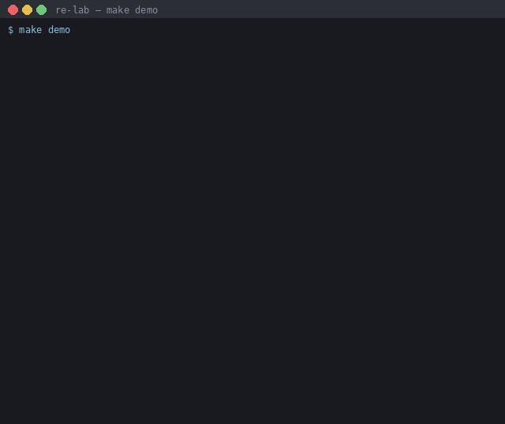
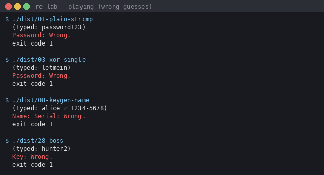
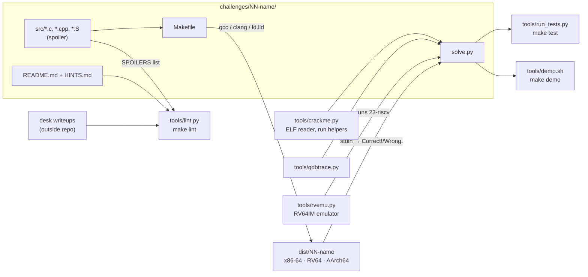
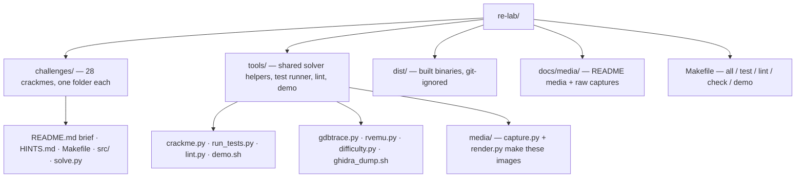
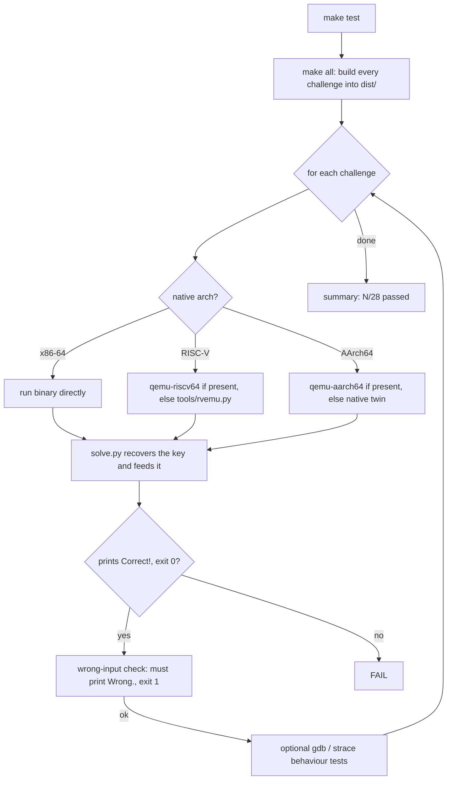
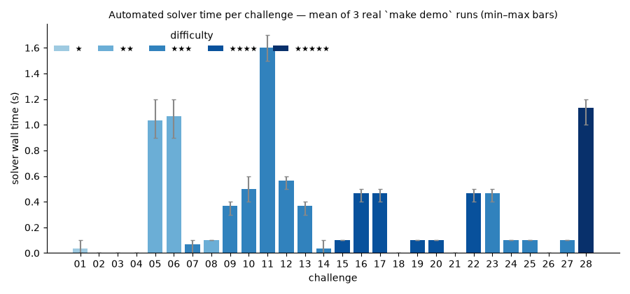
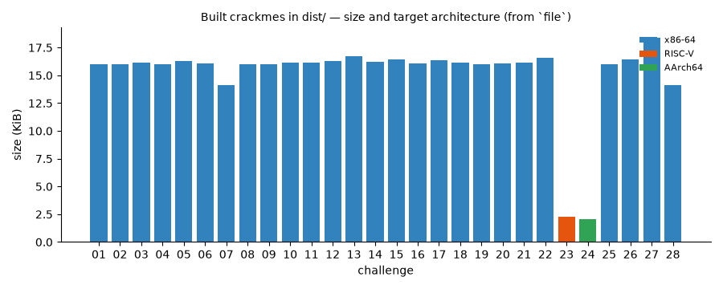

# re-lab — a self-made reverse engineering course

28 original, harmless Linux crackmes that get steadily harder, built to
practise with Ghidra, gdb (+GEF), objdump, strace and ltrace. Path: plain string
compare → stack strings → XOR → math keys → stripped binaries → keygens →
anti-debug → self-modifying code → hand-made control-flow flattening → custom VM →
multi-stage final boss. The day-by-day plan is in [PLAN.md](PLAN.md), the log in
[PROGRESS.md](PROGRESS.md).



*A real `make demo` run (clean build, then each `solve.py` against its binary), replayed at its recorded pace. Captured by `tools/media/capture.py`.*

Every crackme reads one line (08: two lines, name then serial) from stdin and prints `Correct!` (exit 0) or `Wrong.`
(exit 1). No networking, no files touched, nothing persistent.

## Build and test
```
make all     # build every challenge into dist/ (git-ignored)
make test    # builds, then runs each solve.py + a wrong-input check
make lint    # required files present, README briefs leak no spoilers
make check   # rvemu self-test + test + test-z3 + lint
make test-z3 # z3 solvers (solve_z3.py) for 05 and 08; symbolic part skipped if z3 missing
make clean
make demo    # clean build + solve all, summary table, exits 0 iff 28/28 (tools/demo.sh)
```
Requires `gcc`, `make`, `python3`, `objdump` (binutils). The 10-ptrace, 11-timing and
12-int3-scan, 16-cff-manual and 17-opaque tests also use `gdb` (and 10 uses `strace`) when installed (skipped otherwise).

## Play
```
make all
./dist/01-plain-strcmp
```
Read only `challenges/NN-name/README.md` (the brief). **Spoilers:** `src/`, `solve.py`.
Full writeups live outside this repo, in the owner's desk
(`~/Personal-Desk/06-security/reverse-engineering/re-lab/notes/`).



*What playing looks like: real wrong guesses against 01, 03, 08 and 28. No answers are shown.*

## Layout
```
challenges/NN-name/
  README.md     brief: goal, difficulty, allowed tools (no spoilers)
  HINTS.md      three graded hints in <details> blocks
  Makefile      builds $(DIST)/NN-name
  src/          source (spoiler) + SPOILERS (secret strings, used by lint)
  solve.py      automated solver = the test
tools/
  run_tests.py  test runner (make test)
  lint.py       structure/spoiler lint (make lint); also requires a spoiler-marked desk writeup per challenge
  demo.sh       final demo (make demo)
  crackme.py    helpers shared by solvers (run/accepted, strings, tiny ELF64 reader:
                sections, symbols, bytes at a vaddr)
  gdbtrace.py   gdb value tracer: print an expression on every breakpoint hit
                (dispatcher state traces for flattened code; --hw option)
  new-challenge.sh NN-name   scaffold a new challenge
  README.md     what each tool does, with examples
  media/        capture.py (runs the project, records output) + render.py (makes docs/media/)
```

## How it fits together


### Repo map


### `make test` pipeline


## Difficulty
Generated by `python3 tools/difficulty.py` from each challenge brief. Every challenge also has a `HINTS.md` with three folded hint levels (nudge → direction → near-spoiler); `make lint` checks it has all three and leaks no key.

| # | Challenge | Difficulty | Time |
|---|---|---|---|
| 01 | 01-plain-strcmp | ★☆☆☆☆ | warm-up, 5–15 minutes |
| 02 | 02-stack-strings | ★☆☆☆☆ | 10–20 minutes |
| 03 | 03-xor-single | ★★☆☆☆ | 20–40 minutes |
| 04 | 04-xor-rolling | ★★☆☆☆ | 30–60 minutes |
| 05 | 05-math-key | ★★☆☆☆ | 40–60 minutes |
| 06 | 06-serial-format | ★★☆☆☆ | 45–75 minutes |
| 07 | 07-stripped | ★★★☆☆ | 60–90 minutes |
| 08 | 08-keygen-name | ★★☆☆☆ | 45–75 minutes |
| 09 | 09-custom-hash | ★★★☆☆ | 60–120 minutes |
| 10 | 10-ptrace | ★★★☆☆ | 45–90 minutes |
| 11 | 11-timing | ★★★☆☆ | 45–90 minutes |
| 12 | 12-int3-scan | ★★★☆☆ | 45–90 minutes |
| 13 | 13-env-checks | ★★★☆☆ | 45–90 minutes |
| 14 | 14-smc-xor | ★★★☆☆ | 45–90 minutes |
| 15 | 15-smc-layers | ★★★★☆ | 60–120 minutes |
| 16 | 16-cff-manual | ★★★★☆ | 60–120 minutes |
| 17 | 17-opaque | ★★★★☆ | 60–120 minutes |
| 18 | 18-vm-intro | ★★★★☆ | 60–120 minutes |
| 19 | 19-vm-check | ★★★★☆ | 1.5–3 hours |
| 20 | 20-vm-obf | ★★★★☆+ | 2–4 hours |
| 21 | 21-packed | ★★★★☆ | 1–3 hours |
| 22 | 22-antidebug-mix | ★★★★☆ | 1.5–3 hours |
| 23 | 23-riscv | ★★★☆☆ | 45–90 minutes |
| 24 | 24-aarch64 | ★★★☆☆ | 60–90 minutes |
| 25 | 25-constraints | ★★★☆☆ | 45–90 minutes |
| 26 | 26-signals | ★★★★☆ | 1–2 hours |
| 27 | 27-cpp-vtables | ★★★☆☆ | 45–90 minutes |
| 28 | 28-boss | ★★★★★ | stage 1: 1–3 hours, stage 2: 2–4 hours, stage 3: 1–2 hours |



*Wall time of each automated solver, mean of three real `make demo` runs (demo prints 0.1 s resolution). The timing (11) and keygen-search (05, 06) solvers and the 3-stage boss (28) are the slow ones. In one of five runs on a busy machine (load ≈ 7) 11-timing failed its timing window right after the clean build; it passed on re-run.*



*Every built binary in `dist/`: 26 x86-64, one RISC-V (23) and one AArch64 (24).*

## Status
As of Day 30 (2026-11-10, final): **complete.** All 28 challenges build, `make check` passes (28/28, lint clean) and `make demo` solves 28/28. Known gaps: z3 symbolic paths, qemu-user runs and Ghidra headless were never exercised on this machine (tools missing); see PROGRESS.md.

| # | Challenge | Topic | Status |
|---|---|---|---|
| 01 | 01-plain-strcmp | password in `.rodata`, `strcmp`, decoys | ✅ built + solver passes |
| 02 | 02-stack-strings | password built byte-by-byte on the stack, custom compare | ✅ built + solver passes |
| 03 | 03-xor-single | single-byte XOR blob in `.rodata`, decoy string | ✅ built + solver passes |
| 04 | 04-xor-rolling | 5-byte repeating XOR key + chained add | ✅ built + solver passes |
| 05 | 05-math-key | 12-digit key, six arithmetic rules via function-pointer table | ✅ built + keygen/fuzz solver passes |
| 06 | 06-serial-format | `XXXX-XXXX-XXXX-XXXX` serial, weighted check chars, keygen | ✅ built + keygen/model solver passes |
| 07 | 07-stripped | stripped `-O2`, constants in `.data`, modular inverse | ✅ built + solver (parses stripped disassembly) passes |
| 08 | 08-keygen-name | name → serial (rotl/xor/imul hash), two-line input, keygen | ✅ built + keygen solver passes |
| 09 | 09-custom-hash | 64-bit invertible hash, meet-in-the-middle preimage | ✅ built + MITM solver passes (< 1 s) |
| 10 | 10-ptrace | constructor + double `PTRACE_TRACEME`, silent decoy under a debugger | ✅ built + solver/anti-debug tests pass |
| 11 | 11-timing | `rdtsc` + `clock_gettime` timing window, silent decoy when slowed down | ✅ built + solver/gdb timing tests pass |
| 12 | 12-int3-scan | self-hash of its own `.text` region + `0xCC` count, decoy under software breakpoints; post-link hash patch | ✅ built + solver/gdb breakpoint tests pass |
| 13 | 13-env-checks | TracerPid + LD_PRELOAD/LD_AUDIT + parent `comm` checks via raw syscalls, decoy path | ✅ built + solver/anti-debug tests pass |
| 14 | 14-smc-xor | `verify()` XOR-encrypted in `.text`, self-decrypted at runtime via `mprotect`; 1-byte inner key | ✅ built + solver passes |
| 15 | 15-smc-layers | layered SMC: layer 1 static key, layer 2 key derived from the password prefix (FNV-1a gate) | ✅ built + solver passes |
| 16 | 16-cff-manual | hand-made control-flow flattening: random state ids, XOR-delta transitions, branchless edges, dead junk states | ✅ built + solver (static CFG recovery + gdb dispatcher trace) passes |
| 17 | 17-opaque | name/serial keygen behind opaque predicates, junk calls, decoy license checks | ✅ built + keygen solver (gdb confirms decoys never run) passes |
| 18 | 18-vm-intro | tiny stack VM runs bytecode that checks the password | ✅ built + solver with bytecode disassembler passes |
| 19 | 19-vm-check | 8-register VM with loops checks the password | ✅ built + solver (disassembler + emulator) passes |
| 20 | 20-vm-obf | register VM with shuffled opcodes + encrypted bytecode | ✅ built + solver (opcode-map recovery, decrypt, reuse 19 emulator) passes |
| 21 | 21-packed | hand-written packer (LZ77 + LCG-XOR), code unpacked into an mmap page | ✅ built + static-unpacker solver passes |
| 22 | 22-antidebug-mix | ptrace + TracerPid + timing + code checksum, each mixed into the key derivation | ✅ built + static solver + gdb/LD_PRELOAD/breakpoint behaviour tests pass |
| 23 | 23-riscv | freestanding RV64IM binary (clang + ld.lld), runs under qemu-riscv64 or our `tools/rvemu.py` | ✅ built + instruction-count side-channel solver passes |
| 24 | 24-aarch64 | freestanding AArch64 name/serial keygen | ✅ built + static keygen solver passes (run test on a native twin until qemu-aarch64 is installed) |
| 25 | 25-constraints | table of byte constraints | ✅ built + solver passes (fallback search; z3 path used when z3 is installed) |
| 26 | 26-signals | check runs inside SIGSEGV/SIGFPE/SIGILL handlers | ✅ built + solver passes (also checks the signal sequence with strace) |
| 27 | 27-cpp-vtables | g++ class hierarchy; factory + virtual `transform` per 4-byte chunk | ✅ built + solver passes (also checks vtables/RTTI with `nm -C`) |
| 28 | 28-boss | final boss: stage 1 = stripped + anti-debug salts + key-encrypted packed stage 2; stage 2 = custom VM with encrypted bytecode; stage 3 = Feistel keygen (z3 / inversion) | ✅ all 3 stages, full-chain solver passes |

**AArch64:** run through `qemu-aarch64` if installed; otherwise `tools/run_tests.py` skips the run checks for it and the solver tests its keygen on a native x86_64 twin built from the same source.

**RISC-V:** non-native binaries are run through `qemu-riscv64` if installed, else `tools/rvemu.py` (own RV64IM emulator; `make rvemu-test` compares it with a native build, and `make check` runs it).

**Ghidra headless:** `tools/ghidra_dump.sh <binary>` dumps functions, strings and decompiled C; `make ghidra-test` checks it. Currently it skips: Ghidra 12.2 needs JDK 25, and only JDK 21 is installed.

**z3:** `challenges/05-math-key/solve_z3.py` and `challenges/08-keygen-name/solve_z3.py` (run by `make test-z3`) write the check once so it works on both z3 BitVecs and plain ints. The concrete model check always runs. The z3 search runs only when `z3` can be imported (`pip install z3-solver`); otherwise it's skipped with a notice.
